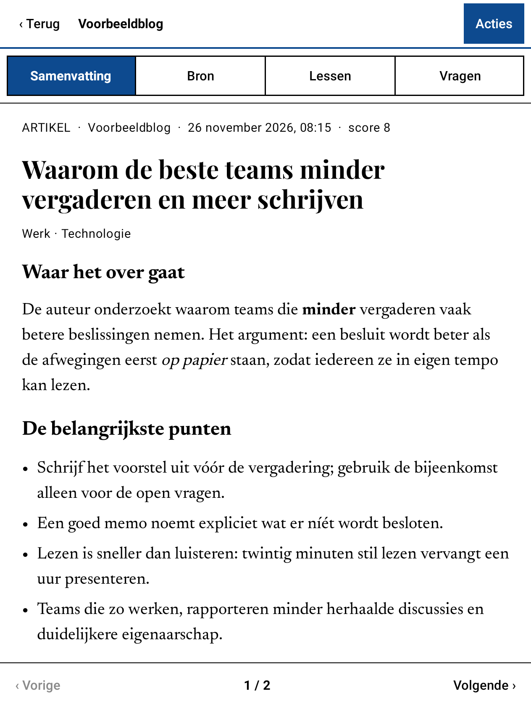
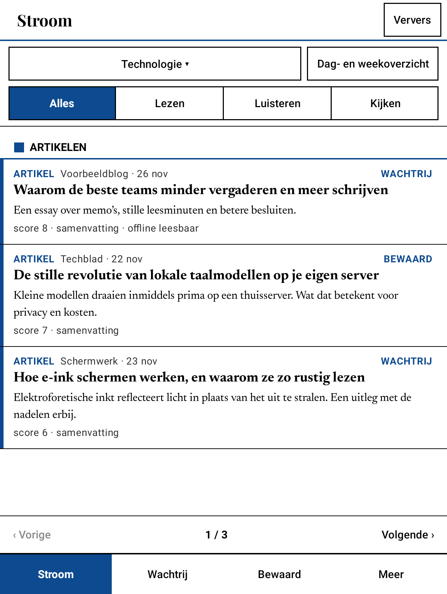
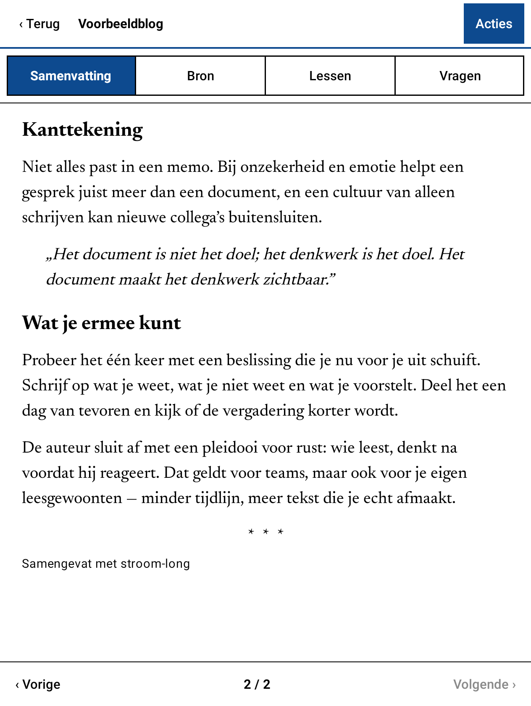
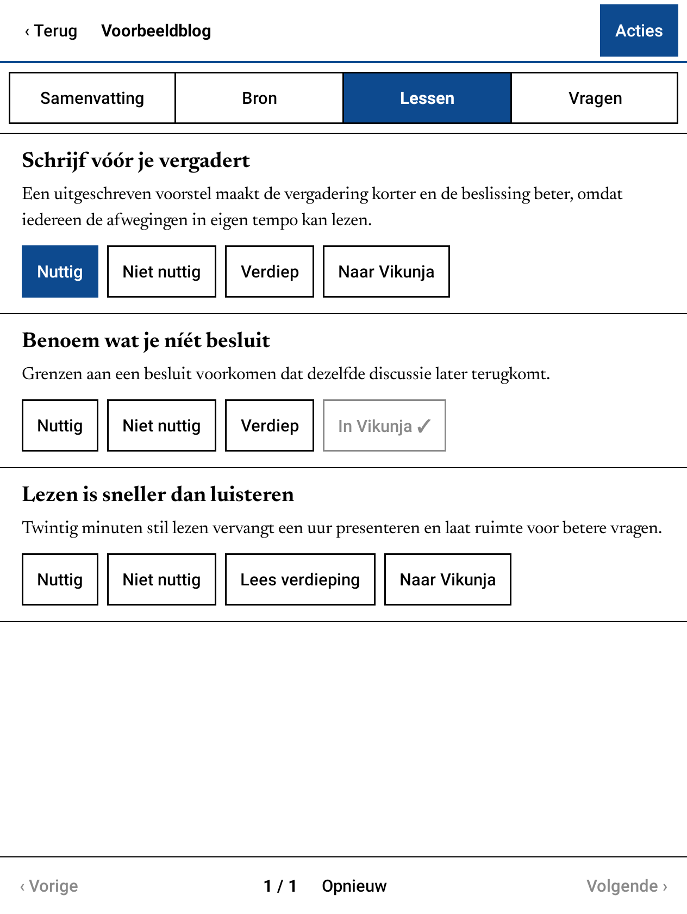
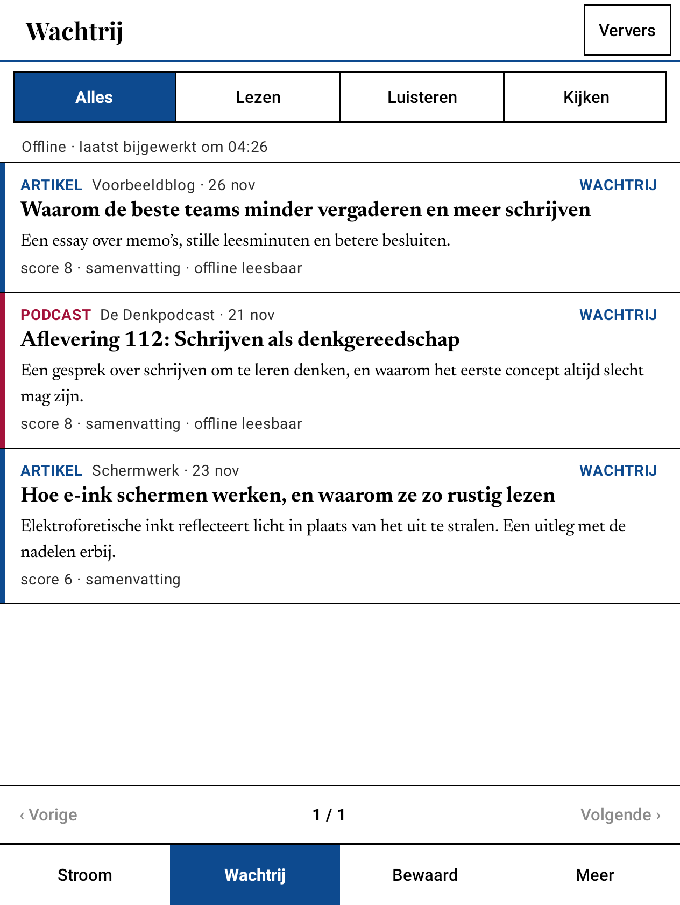
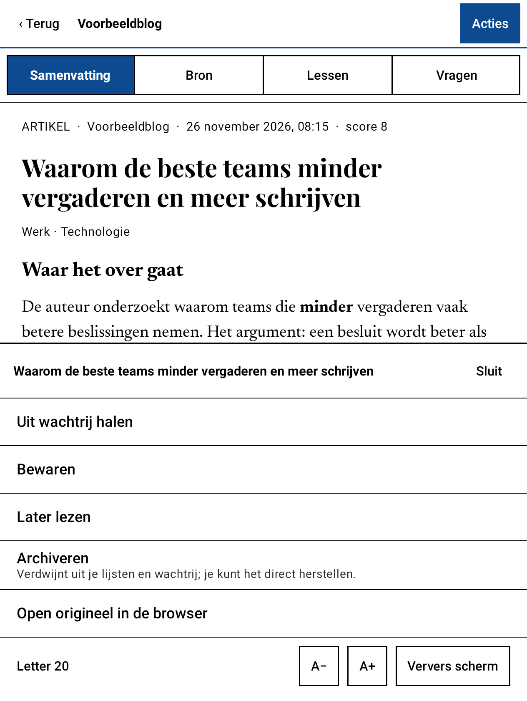
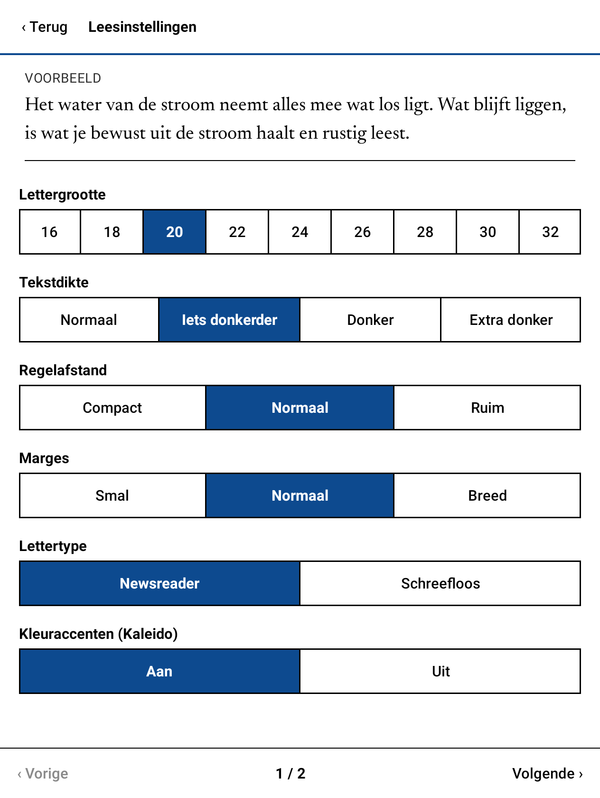

# Stroom voor Boox

Een Android-app voor Stroom, gemaakt voor e-ink en in het bijzonder voor de **Boox Go Color 7 (Gen II)**: 7 inch, Kaleido 3-kleurenscherm, fysieke bladerknoppen. De app gebruikt dezelfde HTTPS-API, login, wachtrij en bewaarde items als de website en de iPhone-app. Aan de server hoeft niets te veranderen.



## Waarom een aparte app

Een e-ink scherm is geen telefoon met een grijs filter. Alles wat beweegt kost een verversing en laat nabeelden achter. Deze app is daarom op vijf punten anders dan de iPhone-app:

1. **Bladeren in plaats van scrollen.** Teksten en lijsten zijn in pagina's verdeeld die precies op het scherm passen. Een pagina breekt nooit midden in een regel, een kop staat nooit onderaan een pagina en een kaartje valt nooit over de rand. Onderin staan altijd *Vorige · 3 / 12 · Volgende*.
2. **Geen animaties.** Geen ripple, overgang, spinner of knipperende laadindicator. Drukken geeft direct een zwarte rand; laden is gewoon tekst.
3. **Zwarte tekst, kleur alleen als accent.** Kaleido 3 toont zwart met 300 ppi, maar kleur met 150 ppi. Daarom is alle tekst zwart. Kleur wordt alleen gebruikt voor de actieve tab, hoofdknoppen en een smalle balk per soort item: artikel blauw, podcast bordeauxrood, video groen. Het zijn verzadigde, donkere tinten, want pastel verdwijnt op Kaleido. Het papier is wit, niet crème: het wit van Kaleido is al grijzig. Op een zwart-wit Boox zet je de kleur uit.
4. **Bladerknoppen en tikzones.** Volumetoetsen, paginatoetsen (de knoppen van de Go Color 7, page turners) en pijltjes slaan om. Tik in de lezer links voor terug en rechts voor verder, of veeg. De knoppen kun je omdraaien voor je andere hand.
5. **Lezen zonder wifi.** Alles in je wachtrij wordt na elke verversing volledig opgehaald en op het apparaat bewaard. Wifi uit spaart batterij; je wachtrij blijft leesbaar.

Elke acht pagina's wist één zwart beeld de nabeelden (instelbaar: nooit, 4, 8 of 16). *Meer → Scherm verversen* doet het direct.

## Wat zit erin

- **Stroom**: per onderwerp de gerangschikte artikelen, podcasts en video's, zoals op de website, met filter op lezen, luisteren of kijken. *Alles* toont de laatste dertig dagen. Het dag- en weekoverzicht per onderwerp staat als gepagineerde tekst klaar en kan ook hier worden gemaakt.
- **Lezer** met tabbladen *Samenvatting*, *Bron*, *Lessen*, *Transcript* (podcast en video) en *Vragen*. De leespositie wordt per item en tabblad onthouden, als tekenpositie: na een andere lettergrootte zie je dezelfde zin.
- **Lessen** destilleren, beoordelen, verdiepen en naar Vikunja sturen. **Vragen** stellen over een item; het antwoord opent als leestekst. Een lange AI-taak loopt door als je het scherm verlaat. Samenvatten en transcriberen kun je aanvragen; de lezer kijkt vanzelf of het klaar is.
- **Wachtrij**: de gedeelde leeswachtrij van de website, in dezelfde volgorde. **Bewaard** en **Zoeken** (titels, samenvattingen en transcripten).
- **Acties** via lang indrukken op een kaartje of de knop *Acties* in de lezer: in/uit wachtrij, bewaren, later lezen, archiveren (met *Herstel*), origineel openen, podcast beluisteren in een andere app. In de lezer staan hier ook A−/A+ en *Ververs scherm*.
- **Link insturen**: deel een link vanuit de Boox-browser of een andere app naar *Stroom*, of vul hem in onder *Meer*. De app haalt titel en beschrijving op; jij kiest soort en onderwerp. Er wordt nooit automatisch verstuurd.
- **Leesinstellingen**: lettergrootte 16–32, tekstdikte (de lettertypen zijn variabel, dus *iets donkerder* is echt dikker en niet vetgedrukt), regelafstand, marges, Newsreader of schreefloos, kleuraccenten, bladerknoppen, tikzones en volledige verversing.

Niet in deze versie: een eigen audiospeler, meldingen en beheer. Podcasts open je met *Beluister in een andere app*; beheer en podcasts maken gaan via de website (*Meer → Open de Stroom-website*).

## Op je Go Color 7 zetten

1. Download `app-release.apk`. Die komt uit de GitHub Actions-run **Boox-app** (onder *Artifacts*) of wordt meegeleverd bij een release.
2. Zet het bestand op de Boox: via USB in de map `Download`, met BooxDrop (*Overdracht* in de Boox-app op je telefoon of via de browser), of open de downloadlink direct in de Boox-browser.
3. Open het bestand in de Boox-bestandsbeheerder. Sta bij de eerste keer *installeren uit onbekende bronnen* toe voor die app.
4. Open Stroom en log in met het adres van je website (`https://stroom.c4w.nl`, zonder `/api`) en je gewone Stroom-account.

### Boox-instellingen die helpen

Houd het Stroom-icoon ingedrukt en kies **Optimaliseren** (of zoek de app op in de *E-Ink Center*). De namen verschillen per firmwareversie; dit zijn de instellingen die ertoe doen:

- **Verversmodus**: *HD* geeft de scherpste tekst. *Gebalanceerd* reageert sneller bij het bladeren door lijsten.
- **Volledige verversing**: laat die op de Boox zelf uit of op een laag ritme. De app regelt dit al per aantal pagina's; twee mechanismen tegelijk geven dubbel knipperen.
- **Kleur**: verhoog desgewenst verzadiging of contrast voor de accenten. Tekst wordt daar niet slechter van.
- **Bladerknoppen**: als de knoppen het volume veranderen in plaats van om te slaan, zet dan in de optimalisatie het gebruik als paginatoetsen aan. Of laat ze als volumetoetsen staan: de app vangt die ook af, zolang *Bladeren met knoppen* aan staat in de leesinstellingen.

## Gegevens en verbinding

- Alleen HTTPS-serveradressen zonder pad worden geaccepteerd; ook de netwerkconfiguratie van de app verbiedt onversleuteld verkeer.
- Het wachtwoord wordt alleen gebruikt om in te loggen en niet bewaard. De sessiecookie wordt versleuteld met een sleutel in de Android Keystore, die het apparaat niet verlaat.
- API-doorverwijzingen naar een andere origin worden geweigerd, zodat de cookie nooit naar een ander adres gaat. Cookies van andere sites worden niet opgeslagen.
- Back-up naar de cloud en apparaatoverdracht zijn uitgeschakeld voor sessie, cache en instellingen.
- Uitloggen trekt de sessie op de server in en wist offline kopieën, leesposities en de lokale feed. Is de server onbereikbaar, dan blijf je ingelogd en krijg je een melding, net als op de iPhone.
- Na het wisselen van account wordt de inhoud van het vorige account eerst gewist.

## Updates en ondertekening

Android installeert een update alleen over de bestaande app heen als die met dezelfde sleutel is ondertekend. Zonder eigen sleutel gebruikt elke build een andere debugsleutel en moet je de app eerst verwijderen. Daarmee raak je je login, leesposities en offline kopieën kwijt. Zo maak je eenmalig een eigen sleutel:

```sh
keytool -genkeypair -v -keystore stroom-boox.jks -alias stroom -keyalg RSA -keysize 4096 -validity 10000
```

- **Lokaal bouwen**: zet het bestand in `boox/` en maak `boox/keystore.properties` met `storeFile=stroom-boox.jks`, `storePassword=…`, `keyAlias=stroom` en `keyPassword=…`. Beide bestanden staan in `.gitignore`.
- **Via GitHub Actions**: zet in de repository-instellingen de secrets `BOOX_KEYSTORE_BASE64` (uitvoer van `base64 -w0 stroom-boox.jks`), `BOOX_KEYSTORE_PASSWORD`, `BOOX_KEY_ALIAS` en `BOOX_KEY_PASSWORD`. Zonder die secrets bouwt de workflow een APK met een tijdelijke debugsleutel.

Verhoog bij een nieuwe versie `versionCode` in `app/build.gradle.kts`.

## Ontwikkeling

Kotlin, Jetpack Compose (alleen foundation, geen Material), OkHttp en kotlinx.serialization. Minimaal Android 8 (API 26); de Go Color 7 Gen II draait Android 13.

```sh
cd boox
./gradlew testDebugUnitTest   # unit- en schermtests
./gradlew assembleRelease     # app/build/outputs/apk/release/app-release.apk
```

Je hebt JDK 17 of nieuwer en de Android SDK nodig (`ANDROID_HOME` of `local.properties` met `sdk.dir`).

| Bestand | Inhoud |
|---------|--------|
| `data/Api.kt` | API-client, foutmeldingen van FastAPI, redirectbeveiliging |
| `data/ContentText.kt` | HTML/Markdown opschonen (zoals `ContentText.swift`) en omzetten naar blokken |
| `data/Storage.kt` | Instellingen, leesposities, offline cache |
| `ui/Pagination.kt` | Pagina-indeling voor tekst en lijsten (zonder Android, los te testen) |
| `ui/Paged.kt` | Gepagineerde tekst en lijsten, vegen, tikzones, bladerknoppen |
| `ui/DocumentBuilder.kt` | Blokken → opgemaakte tekst met koppen, lijsten en citaten |
| `ui/Theme.kt` | Kleurenpalet (Kaleido en zwart-wit), lettertypen, drukfeedback zonder animatie |
| `AppState.kt` | Gedeelde toestand, verversen, acties met herstel, offline synchronisatie |

De lettertypen Newsreader en Playfair Display zijn dezelfde als in de iOS-app en vallen onder de SIL Open Font License (zie `licenses/`). De tabel met HTML-entities komt ook uit de iOS-app.

### Wat de tests dekken

- **Tekstopschoning**: entities, dubbel geëscapete HTML, onveilige links, Markdown-blokken en inline opmaak. Losse sterretjes blijven tekst. Transcriptsegmenten worden per spreker gebundeld en kapotte segmenten overgeslagen.
- **Paginering**: pagina's passen, witregels staan nooit bovenaan, koppen blijven bij hun tekst, en de positie blijft behouden na een andere lettergrootte.
- **API-client (tegen een nepserver)**: login en cookie, geweigerde redirect naar een andere origin, foutmeldingen, tolerant decoderen en validatie van het serveradres.
- **Schermtests (Robolectric en Roborazzi) op 1264 × 1680 px**: inloggen, home in kleur en zwart-wit, de lezer (twee pagina's en grote letter), lessen, het actiemenu, de wachtrij offline en de leesinstellingen. De beelden in [`review/`](review/) komen uit deze tests, met expliciete voorbeeldinhoud.

**Nog op het apparaat zelf testen:** echt inloggen op je server, de bladerknoppen van de Go Color 7 (welke toetscode ze sturen hangt af van de Boox-instelling), hoe de zwarte flits er op Kaleido uitziet, lezen in vliegtuigmodus na een verversing, en delen vanuit de Boox-browser.

| Home | Lezer | Lessen |
|------|-------|--------|
|  |  |  |
|  |  |  |
